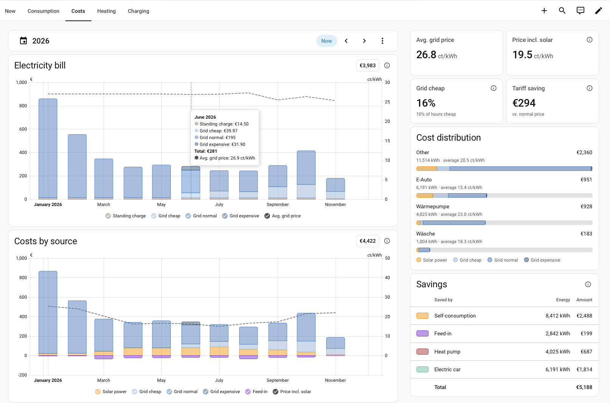
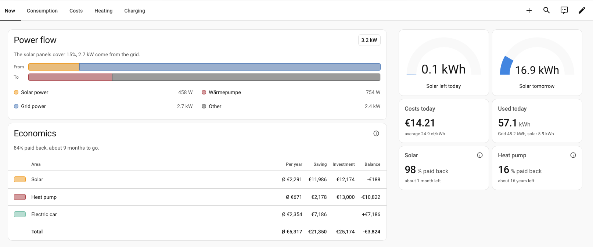
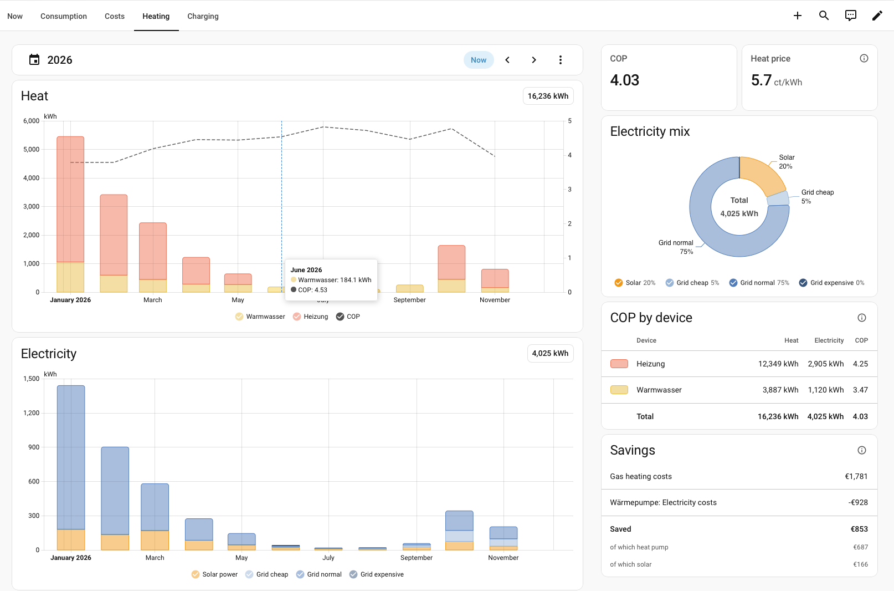
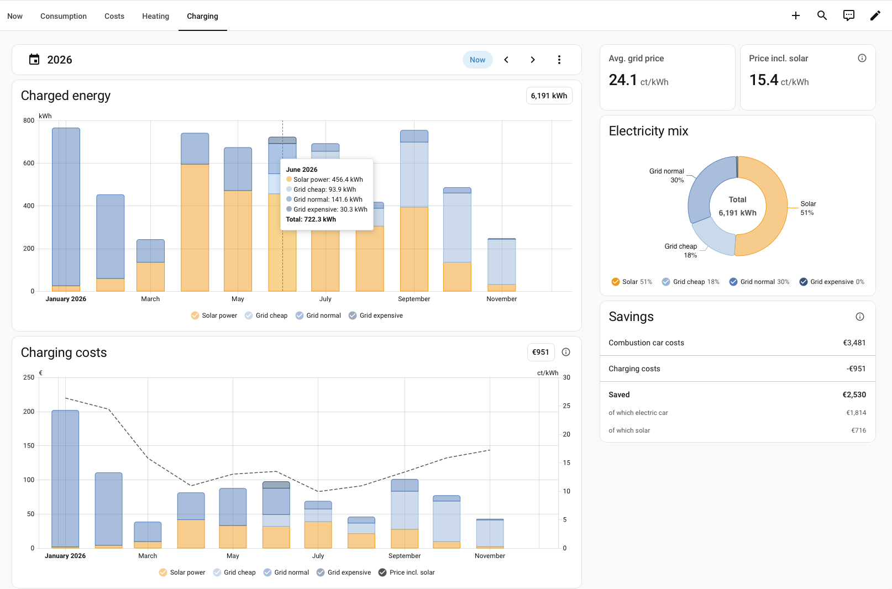

# Electricity Lens

[](https://hacs.xyz/docs/faq/custom_repositories)
[](https://github.com/ignazhabibi/ha-electricity-lens/releases)

**What your electricity really costs, where it comes from, and whether your
solar panels, heat pump, and electric car pay off.**

Home Assistant's energy dashboard shows what you consumed, produced, and paid.
Electricity Lens answers the questions that come next:

- What did each device cost me, including the solar power it used?
- How much of my grid power did I buy in cheap hours, and what did that save?
- What has each investment saved so far, and has it paid for itself yet?
- Is the whole electrification in the plus already?

It takes everything it can from the energy dashboard and computes your whole
history, hour by hour, right after setup. There is no YAML, no helper, and no
template sensor to write.

> [!IMPORTANT]
> Electricity Lens is carefully reviewed and tested, but you use it at your own
> risk. It is provided as is, without warranty (see the [license](LICENSE)).
> Its figures are computed from the data in your Home Assistant and can only be
> as right as that data. They are not financial, tax, or investment advice:
> check decisions that matter against your bills.

> [!NOTE]
> Right after setup, Electricity Lens computes your whole history, hour by
> hour. Depending on how many years of data Home Assistant has, this takes a
> few minutes, and on weaker hardware such as a Raspberry Pi considerably
> longer. Until then the cards say how far it is, and a restart in between
> continues where it stopped.



## Contents

- [What you get](#what-you-get)
- [Requirements](#requirements)
- [Installation](#installation)
- [Setup](#setup)
- [The dashboard](#the-dashboard)
- [The cards](#the-cards)
- [How it calculates](#how-it-calculates)
- [Sensors and statistics](#sensors-and-statistics)
- [Changing things later](#changing-things-later)
- [FAQ](#faq)
- [Troubleshooting](#troubleshooting)
- [Known limitations](#known-limitations)
- [Removal](#removal)

## What you get

Electricity Lens is one package with three parts. HACS installs and updates
them together.

| Part | What it does |
|---|---|
| **The integration** | Values every hour of your energy data: consumption, solar power, and costs of the household, of each device, and of "Other"; the savings of solar, heat pump, and electric car against what they replaced. It keeps the results as long-term statistics, from your first data on. |
| **A dashboard** | A finished electricity dashboard with the views Now, Consumption, Costs, Heating, and Charging. It shows only what your household has, with no settings. |
| **Seven cards** | Power flow, economics, savings, heat meters, history, key figures, and breakdown, for your own dashboards, set up in the card editor. |

Besides, each saving is a sensor you can use in automations, for example to
get a notification when the heat pump has paid for itself.

What it covers:

| Area | Always or optional | What you see |
|---|---|---|
| Household | Always | Consumption, costs, and electricity mix of the household, each device, and Other; the electricity bill; price levels and the tariff saving |
| Solar | With solar production in the energy dashboard | Production, self-consumption, saving, payback, a home battery's part, the solar forecast |
| Heat pump | With its meters under *Individual devices* | Electricity and its costs, heat, COP, heat price, saving against the former heating, payback |
| Electric car | With the wallbox meters under *Individual devices* | Charged energy and its costs, costs per 100 km, saving against a combustion car, payback |

Everything runs locally in Home Assistant. Electricity Lens calls no online
service and sends no data anywhere.

## Requirements

- Home Assistant 2026.10 or newer.
- An [energy dashboard](https://my.home-assistant.io/redirect/config_energy/)
  with a grid import and an electricity price: a fixed price, a price entity,
  or a cost statistic. Dynamic tariffs such as Tibber, Octopus, or Nord Pool
  prices work through their price entity.
- For **solar**: at least one solar production source. Several sources and
  home batteries count as one solar system. A feed-in meter is recommended;
  without one all solar power counts as used in the house, and the setup warns
  about it.
- For the **heat pump** and the **electric car**: their electricity meters
  under *Individual devices* in the energy dashboard. A total meter, or the
  parts that add up to it, such as heating and hot water, or two charging
  points. Heat meters are optional.

## Installation

[](https://my.home-assistant.io/redirect/hacs_repository/?owner=ignazhabibi&repository=ha-electricity-lens&category=integration)

1. Set up the energy dashboard with grid import and electricity price, your
   solar production, and the meters of heat pump and wallbox under
   *Individual devices*.
2. Install Electricity Lens from the Marketplace (Settings › Marketplace) or
   HACS as a custom repository: `https://github.com/ignazhabibi/ha-electricity-lens`,
   type *Integration*.
3. Restart Home Assistant.
4. Add the integration:
   [](https://my.home-assistant.io/redirect/config_flow_start/?domain=electricity_lens)
   or **Settings › Devices & services › Add integration › Electricity Lens**.
5. Follow the [setup](#setup).
6. Add the dashboard: **Settings › Dashboards › Add dashboard**, under
   *Community dashboards*: **Electricity Lens**. The cards are in the card
   picker as well. There is no dashboard resource to add: the integration
   serves the cards itself and updates them with the integration.

The past is computed in the background right after setup; on weaker hardware
this can take a while (see the note at the top).

## Setup

The setup asks only for what Home Assistant cannot know, such as what the heat
pump cost extra or what gas cost on average. A step appears only when your
household needs it.

1. **Overview**: what the energy dashboard provides, and which savings to
   evaluate. The household is always computed; solar, heat pump, and electric
   car are optional. Nothing is preselected, and only possible categories are
   offered.
2. **Household**, optional: the **standing charge per month**, as on the
   electricity bill. It is shared evenly over the hours of its month and added
   to the grid costs. The first value applies from the beginning.
3. **Solar**: since when it counts, and the purchase cost (optional). With a
   battery in the energy dashboard, its purchase cost too (optional), for its
   own payback; the solar payback counts both, so enter the plant's cost
   without the battery.
4. **Heat pump**:
   | Field | Description |
   |---|---|
   | Electricity consumption | The heat pump's meters from the energy dashboard's individual devices. |
   | Produced heat (optional) | Heat meters for the same parts as the electricity meters. An hour counts as measured when every heat meter has data for it. |
   | Former heating | Gas, heating oil, LPG, pellets, district heating, or an electric heating such as storage heaters; or none, as in a new build. Without one there is nothing to compare with: the heat pump has no saving, no saving sensors, and no place in the economics, but its heat, COP, heat price, and the Heating view. |
   | Extra cost (optional) | Extra purchase cost over the former heating, for the payback. Not with no former heating. |
5. **Heat pump, average since the first data**:
   | Field | Description |
   |---|---|
   | Price of the former heating | Average per kWh (gas, district heating, heating electricity), per litre (heating oil, LPG), or per kilogram (pellets). Also the current value from now on. Not with no former heating. |
   | COP | Only asked without heat meters, or when the heat data begins later than the electricity data; the step names until when it estimates. Later gaps use the COP measured until then. |
   | Own electricity tariff (optional) | Only with a separate heat pump tariff. |
   | Price sensor (optional) | Replaces the average from the setup on. While it has no value, its last value counts. Not with no former heating. |
6. **Electric car**: charging meters, what it is compared with (a combustion
   car or nothing), and the extra purchase cost over a combustion car
   (optional). Compared with nothing, as for a second car, the car has no
   saving, no saving sensors, and no place in the economics, but its charging
   costs, mix, and the Charging view.
7. **Electric car, average since the first data**: consumption of the electric
   car (measured at the wallbox, with charging losses; with several cars,
   their average), consumption of a comparable combustion car, fuel price, an
   own tariff (optional), and a fuel price sensor (optional). Compared with
   nothing, only the own tariff (optional).

Then assign areas to the new devices if you like.

## The dashboard

Electricity Lens brings a finished electricity dashboard. Add it under
**Settings › Dashboards › Add dashboard**, under *Community dashboards*:
**Electricity Lens**. Or in YAML:

```yaml
strategy:
  type: custom:electricity-lens
```

It has no settings. It asks the integration what the household has and shows
only the views and cards that fit: costs by device need individual devices in
the energy dashboard, and shares by source need solar power or a grid price
with levels in the last 30 days. Each view answers one question, and each card
has one home; only the first view repeats headline figures, always for today.
The other views follow the energy date selection.

| View | Question | Shows |
|---|---|---|
| Now | How is today going? | Where the power comes from and where it goes right now, with a power sensor for the grid in the energy dashboard; the economics card, which always shows the current state; the solar forecast for the rest of today and for tomorrow as gauges up to the best solar day of the last twelve months, red below about a third of it and green from about two thirds once the data covers a year; costs and consumption today; each investment's payback, and once paid back its return |
| Consumption | Where does my electricity come from, and where does it go? | Consumption by source; solar production and forecast; consumption over time by device; power flow, electricity mix, self-sufficiency, and self-consumption |
| Costs | What does my electricity cost, and what did I save? | The electricity bill with the grid price; the costs of all consumption by source, solar power included, with the average price; the same costs by device; average grid price and average price; where the grid price had levels in the last 30 days, the share of grid power from cheap hours and the tariff saving, and the share from expensive hours where there were some; devices ranked and split by source; the savings of the period as a table |
| Heating | How efficiently does the heat pump heat, and what does it save? | Heat with the COP; its electricity by source; its costs by source with the average price; COP, heat price, its electricity mix, heat, electricity, and COP per meter, and, with a former heating, its saving reckoned up |
| Charging | What does charging cost, and where does the power come from? | Charged energy by source; charging costs by source with the average price; average grid price and average price, the charging mix, and, compared with a combustion car, the saving reckoned up |

**Now**: the power right now, the economics, the solar forecast, and today's
figures.



**Heating**: heat and COP, the heat pump's electricity by source, its mix, the
COP per meter, and its saving against the former heating.



**Charging**: charged energy and charging costs by source, the charging mix,
and the saving against a combustion car.



Whoever wants more takes control of the dashboard (⋮ › *Take control*) and
builds on with the same cards. A dashboard taken over keeps its views, so later
releases no longer change its layout.

### Colors

All cards share one color system built on Home Assistant's energy and graph
colors, so themes that change those change the cards too:

- Solar power is the solar color. Grid power is one family: cheap is light,
  normal is the grid color, expensive is dark. The feed-in is the return color
  and shows below the line.
- Devices take Home Assistant's graph colors in the order of the energy
  dashboard, as in its own graph of individual devices. The heat pump has one
  fixed red of its own, never the gas color; the car has the color of its
  device. "Other" is grey.
- A battery has the energy dashboard's battery colors: one while it gives
  power, one while it takes it.
- Bars are amounts. Prices and ratios are thin dashed grey lines on the right
  axis; prices step, because an hour's price holds for the whole hour. Lines
  of other statistics are dotted.

## The cards

All cards are in the card picker under their names, in Home Assistant's
language, English or German, and follow light and dark themes on phones and
desktops. Like Home Assistant's energy cards, those that follow the energy date
selection take `collection_key` in YAML, for a date selection with a key of its
own; without one they follow the dashboard's.

Their legends name only what occurs in the period, or in the period compared
with: a month without expensive hours has no "Grid expensive", and without
cheap or expensive hours the grid power is just "Grid". Where the numbers need
a rule to be understood, an info icon at the end of the header explains them,
as on Home Assistant's self-sufficiency gauge. A pointer shows it while over
the icon; a tap keeps it open.

| Card | Shows | Options |
|---|---|---|
| [Power flow](#power-flow) | Where the power comes from and goes right now | Title |
| [Economics](#economics) | Savings, investments, and balance of each area since counting began | Title |
| [Savings](#savings) | What was saved in the selected period | Area |
| [Heat meters](#heat-meters) | Heat, electricity, and COP per heat pump meter | None |
| [History](#history) | A figure over time as bars | Period, area, figure, split, lines |
| [Key figures](#key-figures) | One figure for a period | Period, source, area, figure |
| [Breakdown](#breakdown) | Shares of a whole as a ring or bars | Period, area, split, display |

### Power flow

Where the power comes from right now and where it goes, as two bars of the same
length: above the solar panels, the battery, and the grid; below each consumer,
Other, the battery, and the feed-in. In equals out, so the bars fit any
household, with any number of devices. A sentence above says how much of the
consumption the own power covers, and a list below names each part with its
power; a part with one sensor opens its dialog. The chip shows the power the
house takes.

The card reads the power sensors of the energy dashboard: those of the grid,
the solar panels, and the battery, and those of the individual devices. It
needs one for the grid. Devices that belong to a category show as that
category, as in the consumption by device; Other is the consumption minus the
devices with a power sensor. The card follows the sensors' states, without
statistics.

### Economics

The card finds the areas by itself and is built like the totals table of Home
Assistant's energy dashboard: one row per area with what it saves per year on
average, what it has saved, its investment, and its balance, then a row with
the totals. Above the table a sentence says how much of all investments is
paid back and, once there are yearly savings, in about how long everything is
in the plus. Below solar a quieter row shows its battery's part. Without any
investment only the savings appear. A row opens its sensor, which also says
since when it counts. The card can be used with keyboard and screen reader.

### Savings

What was saved in the selected period, as a table: by self-consumption, by the
feed-in, by the heat pump, and by the electric car, each with its energy and
amount. The info icon says what each row counts, for example what the former
heating would have cost. The amounts are those of the economics card, so they
add up without counting solar power twice; the saving on the Heating and
Charging views includes the device's solar power and can be higher. The card
follows the energy date selection, without one this month. Where a period
holds a saving but no energy, the energy shows as a dash: the household's
figures can begin later than the savings.

With `area: heat_pump` or `area: wallbox` it reckons up that area's saving
instead: what the former heating or a combustion car would have cost, less the
heat pump's electricity costs or the car's charging costs, and how the saving
splits: the part the economics card counts for the heat pump or car, and the
part it counts for solar, which gets the benefit of solar power. The card
editor offers only the areas that are set up.

### Heat meters

COP by device: heat, electricity, and COP of each of the heat pump's meters in
the selected period, for example heating and hot water, with their total below.
It needs a heat meter per electricity meter and has no options.

### History

A figure per hour, day, month, or year as bars, in the look of the energy
dashboard, set up in the card editor. Without options it shows what each
category saved, stacked by category; a month in which a category cost more
than it saved shows below the line.

| Option | Choices |
|---|---|
| Period | *Follow the date selection*, a fixed period such as last month or this year, or all years from the first one with a value |
| Area and figure | The savings of all areas, or an area's consumption, costs, savings, or feed-in |
| Split | By source (solar, cheap, normal, and expensive grid power, for the household with the feed-in below the line and outside the total) for consumption and the costs of the household, heat pump, and car; for the household's costs also by bill item (standing charge and grid power by price level, without the feed-in); by device (top-level devices and Other) for the household's consumption and costs; or none |
| Line | A share or price of the same area on a second axis, for example the average price or the self-sufficiency; for the household also the grid price |
| Further lines | Any statistics, for example the outside temperature: their mean, or their total for meters |

With an *Energy date selection* card on the same dashboard it follows the
selected period as the energy dashboard does: hours for a day, days for a week
or month, months for a year. When the date selection compares with an earlier
period, its bars stand paler next to the selected ones. Without a date
selection it shows the savings per year since counting began, other figures
for this month. The chip at the top shows the total of the bars.

```yaml
type: custom:electricity-lens-history-card
area: household
figure: energy
stack: source
line: price
lines:
  - statistic: sensor.outside_temperature
```

### Key figures

One figure for a period as a small card, like the stat cards of the energy
dashboards; several figures are several cards. The period is *Follow the date
selection* (this month without an *Energy date selection* card), or a fixed one
such as today, last month, or this year, so the card also works on dashboards
without a date selection.

A card has one of three sources:

| Source | Shows |
|---|---|
| Energy data | A figure of an area, computed by Electricity Lens, usually with a line below that explains it; `secondary: none` in YAML hides the line |
| Statistic | Any statistic of Home Assistant, as it is: its total over the period for a meter, its mean, minimum, or maximum for a measurement; the mean can show the range of the period below. The editor offers only what the statistic has |
| Entity | Any entity's current state, as Home Assistant shows it |

Areas and their figures:

| Area | Figures |
|---|---|
| Household | Consumption, costs, average price, self-sufficiency (solar share), cheap and expensive grid power with the share of hours of that level (where the grid price had it) |
| Grid | Grid import, feed-in, the electricity bill (what the supplier charges, without the feed-in), grid costs with their parts, average grid price, tariff saving (where the grid price had levels) |
| Solar | Solar production, self-consumption, saving (with the solar panels), the battery's part of it (with a battery), solar today and tomorrow (with a forecast in the energy dashboard), payback and return (with an investment) |
| Heat pump | Electricity, electricity costs, average price, average grid price, solar share, heat, COP, heat price, comparison costs (the former heating), saving with the part by solar power, payback and return (with an investment) |
| Electric car | Charged energy, charging costs, average price, average grid price, solar share, distance, costs per 100 km, comparison costs (the combustion car), saving with the part by solar power, payback and return (with an investment) |
| Each device, Other | Consumption, costs, average price, average grid price, solar share, cheap and expensive grid power |

The card computes nothing beyond adding up the hours of the period, taking one
such sum from another, and dividing two of them, for example costs by
consumption; every cost and share per hour comes from the integration.

```yaml
type: custom:electricity-lens-figures-card
period: energy_date
area: household
figure: cost
```

```yaml
type: custom:electricity-lens-figures-card
statistic: sensor.outside_temperature
value: mean
secondary: range
```

```yaml
type: custom:electricity-lens-figures-card
entity: sensor.electricity_price
name: Price now
```

### Breakdown

Shares of a whole for a period, as a ring or as bars, set up in the card
editor. The ring is drawn like the pie of Home Assistant's devices graph: each
share labeled outside, the total in the middle, and a legend below that hides
a share with a tap.

- **By source**: solar power and grid power by price level, for the household,
  a device, or Other.
- **By device**: the household's consumption or costs by top-level device and
  Other, each with its consumption and average price, or a category's devices,
  such as the heat pump's heating and hot water. Bars can be colored by the
  sources of each device, in the bar's own unit: a bar of costs splits by what
  each source cost. A device that would read as zero is left out.
- **Statistics**: the shares of any statistics as they are, in their unit, for
  example the heat for heating and hot water from the heat pump's own sensors.
  They need a total and one unit; otherwise the card says why it shows no
  shares.

A bar whose device or statistic is an entity opens its dialog with a tap. When
the date selection compares with an earlier period, that period shows as a
paler inner ring, or as a thin bar under each bar. The period is *Follow the
date selection* (this month without one) or a fixed period.

```yaml
type: custom:electricity-lens-breakdown-card
area: household
by: consumer
figure: cost
display: bars
color_by_source: true
```

## How it calculates

Electricity Lens reads the recorder's hourly long-term statistics of the meters
in the energy dashboard and values each hour with the prices of that hour. It
checks for newly compiled hours every 15 minutes, and at once when the energy
dashboard changes. When Home Assistant was off, the recorder reports the missed
energy with the next hour, so no energy is lost; prices of the missing hours
are not known and the next hour's price is used. Only the power flow card shows
the current states of the power sensors instead.

### The household

The household is always computed, from the energy dashboard alone. For every
hour Electricity Lens derives:

- **Consumption** of the household (grid import − feed-in + solar production +
  battery discharge − battery charge), of each individual device, and of
  "Other", what the household used beyond its devices. Of a device and its
  sub-devices (*Upstream device* in the energy dashboard), only the outer one
  counts towards "Other". All consumers add up to the household: a meter that
  books several hours at once reports more than the household used in that
  hour, and later hours of "Other" pay the surplus back. A meter that runs back
  was reset or corrected, which counts as no energy.
- **Mix**: how much of each consumption was solar power and cheap, normal, or
  expensive grid power. Solar power used in the house is shared among the
  consumers of that hour in proportion to their consumption. A home battery
  counts as solar power, as in the solar saving.
- **Costs** of each consumption: grid power at what a kWh cost in that hour, or
  at the own tariff of heat pump or electric car for their devices; solar power
  at the feed-in compensation it did not earn, as evcc does. What a kWh cost
  comes from the energy dashboard's costs, which price each kWh at its moment,
  so a car charging in the cheap minutes of an hour pays less than the hour's
  mean price. Where those costs do not fit the prices of the hour, for example
  after a gap in the meter, the mean price counts.
- **Grid costs**: imports at what they cost, minus the feed-in compensation,
  plus the standing charge if one is entered. The **electricity bill** is what
  the supplier charges: the imports and the standing charge, without the
  feed-in compensation.

### Price levels and the tariff saving

Price levels follow the grid price on their own; there is nothing to set.

- The **normal price** is the price of most hours of the last 7 days (their
  median), such as the high rate beside a cheap night window.
- Grid power is **cheap** at a price at least 10 % below it and **expensive**
  at least 10 % above, judged by what a kWh cost in its hour.
- So a flat tariff has no levels, a tariff with a cheap window has cheap hours,
  a tariff with three stages or a dynamic one has both, and windows of supplier
  and grid fees that overlap are simply their price. After a change of tariff
  the normal price takes a few days to follow.
- Grid power at an own tariff of heat pump or electric car has one price, so it
  has no level.

The **tariff saving** is what cheap grid power cost less, and expensive grid
power more, than at the normal price. Beside it stands the share of grid power
from cheap hours, compared with the share of hours that were cheap: drawn
evenly, the two would be equal. The tariff saving is not part of the balance,
because the savings already count every kWh at its real price.

### Savings

There are three categories. Each compares reality with the alternative it
replaced.

| Category | Saving | Compared with |
|---|---|---|
| Solar | Solar power used in the house, valued at the electricity price of that hour, plus the feed-in compensation received. A home battery counts as part of the solar panels; its part of the saving is shown on its own. | No solar: all electricity from the grid, no feed-in. |
| Heat pump | What the former heating would have cost for the same heat, minus what the heat pump's electricity cost. | The former heating, with the fixed values below. Heat comes from heat meters where they measured, otherwise from electricity × COP. |
| Electric car | What fuel would have cost for the same distance, minus what the charging electricity cost. | A combustion car. The distance follows from the energy charged at the wallbox and the electric car's consumption. |

- **No double counting.** The three savings add up to the household's total
  saving, the balance before investments. The benefit of solar power belongs
  to the solar panels alone; heat pump and electric car pay for all their
  electricity at the price of that hour, even when the sun delivered it.
- **Costs and savings answer different questions.** A device's costs count its
  solar power at the lost feed-in compensation; in the economics its
  electricity counts at the grid price, solar power or not, so nothing counts
  twice. On the key figures and charts of a heat pump or car, the saving
  includes its solar power, with that part below the key figure.
- **The battery's part.** Of the solar saving, the battery's is what it adds to
  the same solar panels without it: what it gives, valued at the hour's
  electricity price or, when fed in, the feed-in compensation, minus the solar
  power it stores at the feed-in compensation it did not earn and the grid
  power it charges at the hour's price. The rest is what the solar panels saved
  without the battery, so the two add up to the solar saving. An hour's
  statistics do not say which power went where, so the battery is taken to
  charge from solar power first and to give to the house first.
- **Prices at the time of use.** The electricity price of each hour is what the
  energy dashboard charged for it, so dynamic tariffs are handled hour by hour.
  With several tariffs, such as day and night, the average of the hour counts.
  Heat pump and electric car can have an own tariff instead.
- **Measurements are facts.** Electricity Lens never filters or corrects
  readings. If a meter recorded a wrong value, fix it in Home Assistant's
  statistics tools, which also fixes the energy dashboard, then choose
  *Recompute*.
- **Honest numbers.** Savings can be negative for a while, for example when
  electricity is expensive and gas is cheap, and the cards show that. There is
  no yearly average before twelve months of data, because seasons would
  distort it. Heat that was estimated instead of measured is marked as such.

The former heating would have paid per kWh of heat:

| Former heating | Price per | Energy per unit | Efficiency |
|---|---|---|---|
| Gas | kWh | 1 kWh | 92 % |
| Heating oil | litre | 10 kWh | 92 % |
| LPG | litre | 6.57 kWh | 92 % |
| Pellets | kilogram | 4.8 kWh | 88 % |
| District heating | kWh of heat | 1 kWh | 100 % |
| Electric heating | kWh | 1 kWh | 100 % |

### Three phases

Each category counts from the first hour Home Assistant has data for it.

| Phase | What counts |
|---|---|
| Before Home Assistant had data | Nothing. There is no starting value and no import. The card says since when it counts. |
| From the first data to the setup | One average per value (gas, oil, or fuel price, consumptions, COP, own tariff), entered at setup, because Home Assistant does not know earlier prices. |
| From the setup on | The averages as starting values. Changed values and a price sensor apply from the next full hour; what was computed stays, just as the energy dashboard treats a new electricity price. |

## Sensors and statistics

### Sensors

Each category is a device with these sensors; one more device holds the
overall balance. A heat pump without a former heating, or a car compared with
nothing, saves nothing, so it has none: its figures are statistics the cards
show.

| Entity | Description |
|---|---|
| Saving | Total saving since counting began, in your currency. Its history is the statistic *electricity_lens:pv_saving*, *…heat_pump_saving*, or *…wallbox_saving* (named after the sensor), including the computed past; you can pick it in Home Assistant's statistics cards. Its attributes show the statistic's id, since when it counts, the investment, the saving minus the investment, from when yearly figures exist, the gas, oil, or fuel price in effect now, and for the heat pump the former heating and whether heat was partly estimated. The solar's has its battery's part, with its saving, investment, yearly saving, payback, years left, and since when it counts. |
| Paid back | Share of the investment the saving has covered, in percent. Unknown without an investment. Its attributes show the investment and the years left at the yearly average. |
| Saving per year | Average saving per year. Unknown before twelve months of data. |
| Return per year | Internal rate of return so far, in percent per year: the investment at the start of counting, the saving evenly over the years since, and no value left at the end. Zero when the saving has just covered the investment, and unknown before that or without an investment. It leaves out maintenance, and it comes out too high for a plant bought before the data begins. Its attributes show how far the saving has gone beyond the investment. |
| Solar left today, Solar tomorrow | The solar forecast in kWh for the rest of today and for tomorrow over all forecasts of the energy dashboard, updated every 15 minutes. Only with a forecast in the energy dashboard. Their attributes show the best solar day of the last twelve months, the scale of the dashboard's gauges, and whether the data covers all twelve months. |
| Balance | All savings minus all investments. Unknown while any category is calculating or has no data yet. Its attributes show all savings, all investments, the yearly savings, the share of all investments the savings have covered, the years until they cover them at the yearly savings, and, while the past is computed, how far it is in percent. |

Notify when the heat pump has paid for itself:

```yaml
triggers:
  - trigger: numeric_state
    entity_id: sensor.heat_pump_paid_back
    above: 100
actions:
  - action: notify.notify
    data:
      message: "The heat pump has paid for itself."
```

### Statistics

Electricity Lens keeps a long-term statistic of its own for every figure Home
Assistant has no statistic for, including the computed past; it copies none.
They appear in Home Assistant's statistics pickers, for example in the
*Statistics graph* card, under their names such as "Household consumption" or
"Washer costs".

| Statistic | Content |
|---|---|
| `electricity_lens:household_energy`, `…_solar`, `…_cheap`, `…_expensive`, `…_cost` | The household's consumption, its solar power, its cheap and expensive grid power, and its costs |
| `electricity_lens:household_solar_cost`, `…_cheap_cost`, `…_expensive_cost` | What of the household's costs falls on its solar power and on its cheap and expensive grid power |
| `electricity_lens:other_…` | The same for "Other" |
| `electricity_lens:device_<meter>_solar`, `…_cheap`, `…_expensive`, `…_cost`, `…_solar_cost`, `…_cheap_cost`, `…_expensive_cost` | The same for each individual device, without its consumption, which the device's own statistic already holds; `<meter>` is the device's statistic id as a slug, for example `device_sensor_washer_cost` for `sensor.washer` |
| `electricity_lens:grid_cost` | Grid costs: imports minus feed-in compensation plus standing charge |
| `electricity_lens:grid_import_cost`, `…grid_feed_in`, `…grid_standing_charge` | What the imports cost, what the feed-in earned, and the standing charge |
| `electricity_lens:grid_cheap_saving` | The tariff saving: what cheap grid power cost less and expensive grid power more than at the normal price |
| `electricity_lens:grid_hours`, `…grid_cheap_hours`, `…grid_expensive_hours` | The hours counted, and those whose price was cheap or expensive, whatever the household drew |
| `electricity_lens:pv_saving`, `…heat_pump_saving`, `…wallbox_saving` | The categories' savings |
| `electricity_lens:pv_battery_saving` | The battery's part of the solar saving |
| `electricity_lens:heat_pump_heat`, `…heat_pump_alternative_cost`, `…heat_pump_solar_saving` | The heat pump's heat (measured or estimated), what the former heating would have cost for it, and what its solar power adds to its saving |
| `electricity_lens:wallbox_distance`, `…wallbox_alternative_cost`, `…wallbox_solar_saving` | The distance charged, what a combustion car would have paid for fuel, and what its solar power adds to its saving |

Energy is in kWh, money in your currency. Hours in which a figure did not
change are not stored; statistics cards carry the sum over them.

## Changing things later

**Configure** on the integration page changes the household:

| Option | What it does |
|---|---|
| Standing charge | A new standing charge applies from the next full hour. |
| Recompute | Computes everything again with the current data, the household and all categories, for example after you fixed a wrong reading in the statistics. All values stay. |

Categories are config subentries. On the integration page each category has
**Reconfigure** and **Delete**, and there are buttons to add the categories not
set up yet; they lead through the same steps as the setup. **Reconfigure**
opens a menu:

| Option | What it does |
|---|---|
| Values from now on | New prices, consumptions, COP, tariff, or price sensor. They apply from the next full hour. |
| Averages before the setup | Corrects the averages of the time before the setup. That time is computed again. |
| Meters and extra cost | Other meters or another former heating compute everything again; another former heating asks for its prices. The extra cost applies at once. |
| Recompute | Computes the category again with the current data, for example after you fixed a wrong reading in the statistics. All values stay. |
| Purchase cost (solar) | The plant's and the battery's. Applies at once. |

Changes in the energy dashboard are followed automatically: changes to its
grid, solar, battery, or devices compute the household again, and a category
whose meters changed.

The rule behind it: a fact with a date, such as a price or a standing charge,
applies from the next full hour, so what was computed stays. A rule of the
calculation, or a correction of the past, applies to the whole history.

## FAQ

**Why do my costs differ from the energy dashboard?**
The energy dashboard shows what the grid imports cost. Electricity Lens shows
that too, as *grid import cost* and within the *electricity bill*, which also
holds the standing charge. Its *costs* answer another question: what your
consumption cost, so they also count the solar power you used, at the feed-in
compensation you did not earn by using it. Without that, a device running on
solar power would look free.

**Why does the electricity bill differ from my supplier's bill?**
It counts what the energy dashboard's meter and price say, hour by hour. A
price that is wrong in Home Assistant, a missing standing charge, or a bill
period that does not match the month all make a difference. Discounts, taxes
outside the kWh price, and credits are not known to Home Assistant.

**Does it work with dynamic tariffs such as Tibber, Octopus, or Nord Pool?**
Yes. Electricity Lens uses whatever price the energy dashboard has, a price
entity or a cost statistic, hour by hour. Price levels and the tariff saving
follow the prices on their own, so you see how much grid power you bought in
cheap hours.

**I have a flat tariff. Why is there nothing about cheap hours?**
A flat price has no levels, so there are no cheap or expensive hours, and the
dashboard leaves those figures out. The grid power is then just "Grid".

**Why is my heat pump's saving lower than I expected?**
It compares with the former heating's energy price only: the standing charge of
a former gas connection, maintenance, and the chimney sweep are left out. If
you cancelled the gas connection, your real saving is higher. Check too that
the price of the former heating and, without heat meters, the COP are right.

**Why is a saving negative?**
When electricity is expensive and gas or fuel cheap, a heat pump or electric
car can cost more than what it replaced, for a month or longer. Electricity
Lens shows that instead of hiding it.

**Why is there no yearly saving or payback date yet?**
A yearly average needs twelve months of data; before that, seasons would
distort it.

**Does it count solar power twice?**
No. The three savings add up to the balance: the benefit of solar power belongs
to the solar panels, and heat pump and car pay for all their electricity at
the grid price. Only their own views add their solar power to their saving, and
name that part.

**I have a balcony plant without a feed-in meter.**
That works. All solar power then counts as used in the house; the setup warns
about it.

**I have a home battery.**
It counts as part of the solar system. Its part of the solar saving is shown on
its own, with its own payback if you enter its purchase cost.

**How long does the first computation take?**
A few minutes for several years of data, longer on a Raspberry Pi. The cards
show the progress, and a restart continues where it stopped.

**Does it change my energy dashboard or my data?**
No. It only reads the energy dashboard and the recorder's statistics, and
writes statistics of its own under `electricity_lens:`. Deleting the
integration removes them.

**Does it send data anywhere?**
No. It runs locally and calls no online service.

**I fixed a wrong meter reading. How do I update the figures?**
Choose *Configure › Recompute* on the integration page. It computes everything
again with the corrected statistics.

**I took control of the dashboard. Why don't I get new views?**
A dashboard taken over keeps the views it stored. To get the current layout,
add the Electricity Lens dashboard again, or copy the new cards into yours.

**Which languages are there?**
English and German, following Home Assistant's language.

## Troubleshooting

- **Setup ends right away**: the energy dashboard has no grid import with an
  electricity price. The message links to the energy dashboard.
- **Heat pump or electric car are not offered**: their meters must be listed
  under *Individual devices* in the energy dashboard.
- **A figure jumps implausibly**: a meter probably recorded a wrong reading.
  Fix it under **Developer tools › Statistics**, then choose *Configure ›
  Recompute* on the integration page. It computes the household and all
  categories again, as costs and solar power of the devices build on the
  household. If only a category's own meter was wrong, such as a heat meter,
  *Reconfigure › Recompute* for that category is enough.
- **A repair issue says a meter or price sensor is missing**: it was removed.
  The category keeps its last figures, or the sensor's last price. Add it back,
  or choose another one with *Reconfigure*.
- **No payback percentage**: enter the purchase or extra cost.
- **The card says it is calculating for long**: if its percentage no longer
  rises, download the diagnostics from the integration page and open an
  [issue](https://github.com/ignazhabibi/ha-electricity-lens/issues) with them.

## Known limitations

- Not supported: other alternatives than the former heatings above and a
  combustion car, or none; gas prices per cubic metre; the standing charge of a
  former gas or district heating; solar thermal; investments from a helper; and
  fetching prices from online services. Price sensors you already have can be
  used, though.
- The battery's part is split from the solar saving hour by hour, with the
  battery charging from solar power first and giving to the house first. Within
  an hour that charges and gives, or that charges from both, the split between
  the two can differ from what really flowed; their sum cannot.
- The time before the setup is computed with one average per value, because
  Home Assistant does not know earlier gas, oil, or fuel prices. A price
  sensor's history from before the setup is not used.
- Only data Home Assistant has counts. Savings from before Home Assistant
  recorded the energy dashboard cannot be imported.
- Several cars sharing a wallbox use one average consumption.
- The yearly average is a plain average since counting began; the first and
  last partial seasons can make it a little high or low.
- The energy dashboard and the recorder statistics have no public Python
  interface. Electricity Lens keeps all access to them in one module and raises
  a repair issue instead of showing wrong numbers if a Home Assistant update
  changes them.

## Removal

1. Remove the cards from your dashboards.
2. Go to **Settings › Devices & services › Electricity Lens**, open the menu
   (⋮) and choose **Delete**. To remove one category only, use **Delete** in
   that category's menu.
3. Uninstall Electricity Lens in the Marketplace or HACS and restart Home
   Assistant.

Deleting Electricity Lens removes all statistics it wrote; deleting a category
removes that category's saving statistic.

## Contributing

See [CONTRIBUTING.md](CONTRIBUTING.md). Automated coding agents also follow
[AGENTS.md](AGENTS.md). The words on the cards follow [CONTEXT.md](CONTEXT.md).

## License

MIT License — see [LICENSE](LICENSE).
